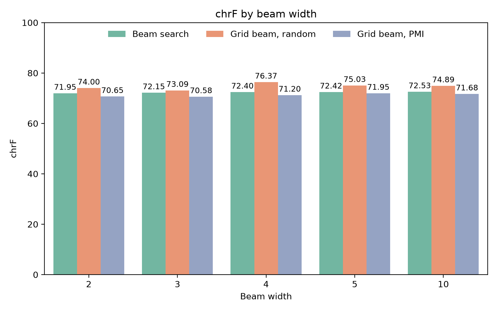

# Grid beam search for constrained translation

A from-scratch reimplementation of grid beam search ([Hokamp and Liu, ACL 2017](https://aclanthology.org/P17-1141/)), a decoding algorithm that forces a translation model to include given words or phrases, tested on English-to-French with T5-small.

## Result

Grid beam search scored a higher chrF than ordinary beam search at every beam width tested, up to **76.4 versus 72.4**.

| Beam width | 2 | 3 | 4 | 5 | 10 |
| --- | --- | --- | --- | --- | --- |
| Beam search | 71.95 | 72.15 | 72.40 | 72.42 | 72.53 |
| Grid beam search | **74.00** | **73.09** | **76.37** | **75.03** | **74.89** |
| Grid beam search, PMI constraints | 70.65 | 70.58 | 71.20 | 71.95 | 71.68 |

chrF on 200 English-French sentence pairs; higher is better. Both decoders use the same model, beam width and length limit. In the "Grid beam search" row, the constraints are 1 to 4 random words or word pairs taken from the reference translation. This is the setting of the original paper: it shows what the decoder does when the right terms are known, for example from a glossary. The PMI row picks constraints from the English source only, without looking at the reference; with those constraints, grid beam search scored below plain beam search.



BLEU and chrF++ show the same pattern ([docs/bleu.png](docs/bleu.png), [docs/chrf_pp.png](docs/chrf_pp.png)). All scores are in [results/scores.csv](results/scores.csv), and the translations behind them are in [results/outputs/](results/outputs/).

## How it works

- Hypotheses are kept in a grid indexed by *c*, the number of constraint tokens covered so far.
- Each decoding step applies three operations. **Generate** adds one of the model's top-k free tokens and keeps *c* the same. **Start** forces the first token of an unmet constraint. **Continue** forces the next token of the constraint in progress. Start and Continue both move the hypothesis to *c* + 1.
- At most one constraint is in progress at a time.
- A hypothesis is pruned once it can no longer fit the remaining constraint tokens before the length limit. End-of-sequence is only allowed after every constraint is in the output.
- Every grid cell keeps its *k* best hypotheses by length-normalised log-probability. The answer is the best finished hypothesis in the last column, the one that covers all constraints.
- **Efficiency:** hypotheses are copied shallowly and share their constraint lists, the encoder runs once per sentence, and constraint progress is tracked with two small lists per hypothesis.
- **PMI constraints:** pointwise mutual information between English and French words is counted over 300,000 sentence pairs. For each source sentence, the French words most strongly tied to its English words become the constraints.

## Quick start

Requires Python 3.10 or newer. Runs on a laptop CPU; a GPU is used when available.

```bash
git clone https://github.com/Magnus-DM/grid-beam-search.git
cd grid-beam-search
python -m venv .venv && source .venv/bin/activate
pip install -r requirements.txt --extra-index-url https://download.pytorch.org/whl/cpu

# One sentence with three constraints (about 30 seconds)
python example.py

# Small benchmark: first 10 sentences, beam width 3 (a few minutes)
python prepare_data.py --n 10
python run_benchmark.py --n-sentences 10 --beam-widths 3 --methods beam grid_random --out runs/quick
```

`example.py` prints something like:

```text
Source:      Solve the riddle lurking behind the murder.
Constraints: ['Résoudre', 'se cache', 'mystère']
Beam search: Solver le dénuement qui se cache derrière le meurtre.
Grid beam:   Résoudre le mystère qui se cache derrière le meurtre.  (score -0.974)
```

To re-score the stored translations from the original run:

```bash
python prepare_data.py           # 200 sentence pairs
python verify_results.py
```

## Data

- **Evaluation set:** the first 200 sentence pairs of [thesistranslation/distilled-ccmatrix-fr-en](https://huggingface.co/datasets/thesistranslation/distilled-ccmatrix-fr-en), a filtered English-French subset of CCMatrix. `python prepare_data.py` downloads them to `data/eval.tsv`. No data is stored in this repository.
- **The reported scores** used the course's copy of these 200 pairs. In that copy, some sentences have a stray quotation mark removed or added, so 77 of the English and 16 of the French sentences differ slightly from the raw dataset. Re-scoring the stored translations against the raw text gives about 0.1 chrF less for every method and beam width; the ranking of the methods does not change.
- **PMI statistics:** `python prepare_data.py --pmi-corpus` downloads shard 1 of the same dataset (about 330 MB) to `data/ccmatrix/`. The first run with `--methods grid_pmi` counts statistics on its first 300,000 pairs and caches them in `data/pmi_statistics.pkl`. The evaluation sentences come from shard 0, so they are never part of these statistics.
- **Full benchmark:** `python run_benchmark.py` runs all three methods at beam widths 2, 3, 4, 5 and 10. This takes several hours on a CPU.
- **Random constraints** are seeded with 42 plus a CRC32 checksum of each sentence, so every run draws the same constraints. The original run seeded with Python's built-in `hash()`, which changes from one run to the next. A fresh run therefore draws different random constraints than the run reported above, and its grid beam scores will differ from the table.

## Project structure

```text
gbs/
  grid_beam_search.py    grid beam search and the constraint-tracking hypothesis
  baseline.py            beam search baseline and BLEU/chrF/chrF++ evaluation (course template)
  random_constraints.py  random constraints from the reference translation
  pmi_constraints.py     constraints picked from the source sentence by PMI
example.py               one sentence, with and without constraints
prepare_data.py          downloads the evaluation set and the PMI corpus
run_benchmark.py         full comparison across methods and beam widths
verify_results.py        re-scores the stored translations
plot_figures.py          bar charts from a scores.csv
results/                 scores and translations from the original run
docs/                    figures
```

## Context

Individual project for the Advanced Natural Language Processing course at KU Leuven, December 2025, about 100 hours. The beam search baseline, its hypothesis class and the evaluation function in `gbs/baseline.py` follow the course's decoding exercise template. Grid beam search, both constraint selectors, the experiments and the speed-ups are my own work.

## References

- Hokamp, C. and Liu, Q. (2017). [Lexically Constrained Decoding for Sequence Generation Using Grid Beam Search](https://aclanthology.org/P17-1141/). ACL 2017.
- Raffel, C. et al. (2020). Exploring the Limits of Transfer Learning with a Unified Text-to-Text Transformer. JMLR 21(140). Model: [google-t5/t5-small](https://huggingface.co/google-t5/t5-small).
- Schwenk, H. et al. (2021). CCMatrix: Mining Billions of High-Quality Parallel Sentences on the Web. ACL-IJCNLP 2021.
- Popović, M. (2015). chrF: character n-gram F-score for automatic MT evaluation. WMT 2015. Computed with [sacreBLEU](https://github.com/mjpost/sacrebleu).

## License

MIT for my own code; see [LICENSE](LICENSE). The baseline in `gbs/baseline.py` is adapted from course material.
